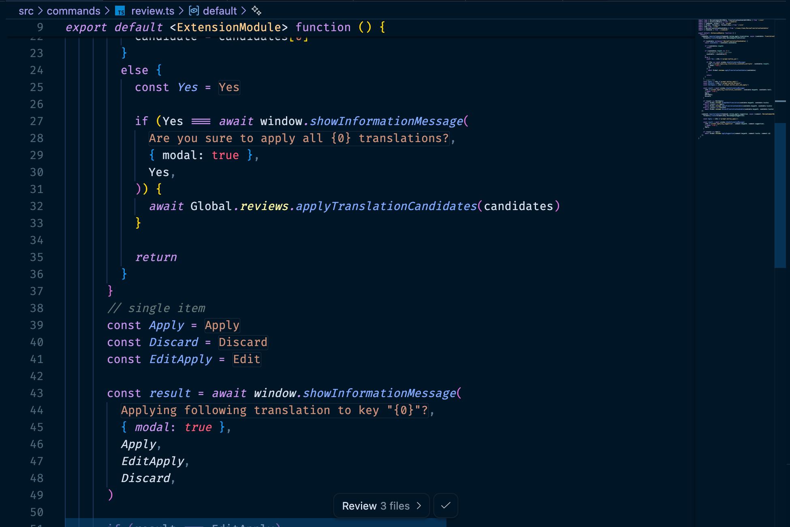

<p align="center">

</p>

<h1 align="center">i18n Ally Next</h1>

<p align="center">
<b>All in one i18n extension for VS Code</b>
</p>

<p align="center">
English | <a href="https://github.com/lydanne/i18n-ally-next/blob/main/README.zh-CN.md">简体中文</a>
</p>

<p align="center">
<a href="https://marketplace.visualstudio.com/items?itemName=lydanne.i18n-ally-next"></a>
<a href="https://marketplace.visualstudio.com/items?itemName=lydanne.i18n-ally-next"></a>
<a href="https://marketplace.visualstudio.com/items?itemName=lydanne.i18n-ally-next"></a>
<a href="https://github.com/lydanne/i18n-ally-next"></a>
</p>

---

## Features

- **🌍 Inline Annotations** — See translations directly in your code
- **🔍 Hover Preview** — Preview all translations with hover, edit in one click
- **📦 Extract Hard Strings** — Detect and extract hard-coded strings to locale files
- **🤖 Machine Translation** — Google, DeepL, Baidu, OpenAI, and Editor built-in LLM (Cursor/Windsurf/VSCode Copilot)
- **🗂 Namespace** — Organize translations with `t("ns:key")` style
- **📝 Review System** — Built-in translation review and collaboration
- **🧩 30+ Frameworks** — Vue, React, Angular, Svelte, Flutter, and more
- **🎨 Custom Framework** — Define your own framework via YAML config
- **⚡ Translate All Missing** — One-click translate all missing and stale keys for any locale
- **🕐 Stale Translation Detection** — Detect outdated translations when source text changes, re-translate one by one or all at once
- **🔎 Scan & Extract All** — Scan entire project for hard-coded strings and batch extract them into i18n keys
- **🧠 Editor LLM Translation** — Auto-detect VSCode and use the built-in LLM for translation with batch support

## Quick Start

```jsonc
// .vscode/settings.json
{
  "i18n-ally-next.localesPaths": ["src/locales"],
  "i18n-ally-next.sourceLanguage": "en",
  "i18n-ally-next.displayLanguage": "zh-CN"
}
```

> The framework is auto-detected from your `package.json`. See [Supported Frameworks](#supported-frameworks) for the full list.

## Screenshots

<h4 align="center">Inline Annotations</h4>


<h4 align="center">Hover and Direct Actions</h4>


<h4 align="center">Extract Translations from Code</h4>


## Supported Frameworks

| Category | Frameworks |
| --- | --- |
| **Vue** | Vue I18n, Vue SFC, Fluent Vue |
| **React** | React I18next, React Intl, Lingui |
| **Next.js** | next-intl, next-i18next, next-translate, next-international |
| **Angular** | ngx-translate, Transloco |
| **Others** | Svelte, Ember, i18n-tag, Polyglot, Globalize, UI5 |
| **Mobile** | Flutter |
| **Backend** | Laravel, Ruby on Rails, PHP Gettext |
| **Tools** | VS Code Extension, Chrome Extension, Jekyll |
| **Custom** | [Define your own framework](https://lydanne.github.io/i18n-ally-next/guide/custom-framework) |

## Inline Annotation Mode

By default, translations are shown as inline annotations after the key. You can customize this behavior:

```jsonc
// .vscode/settings.json
{
  "i18n-ally-next.annotationInPlace": true,
  "i18n-ally-next.annotationInPlaceFullMatch": true
}
```

| Setting | Effect |
| --- | --- |
| `annotationInPlace: false` | `t('key')` · translated text |
| `annotationInPlace: true` | `t(`translated text`)` — hides the key only |
| `annotationInPlaceFullMatch: true` | translated text — hides the entire function call |



> **Note:** When `annotationInPlaceFullMatch` is enabled, moving the cursor to the line will restore the original code for editing. The `annotationMaxLength` limit is automatically disabled in this mode, so translations are shown in full without truncation.

The translated text color in full match mode defaults to `#ce9178` (string color in Dark+ theme). You can customize it:

```jsonc
// .vscode/settings.json
{
  "i18n-ally-next.theme.annotationInPlaceFullMatch": "#ce9178" // Dark theme
  // "i18n-ally-next.theme.annotationInPlaceFullMatch": "#a31515" // Light theme
}
```

## Optional Dependencies

Some advanced features require additional packages to be installed **in your project**:

| Feature | When needed | Install |
| --- | --- | --- |
| **Vue SFC `<i18n>` block** | Using inline `<i18n>` blocks in `.vue` files | Bundled with the extension |
| **Fluent Vue SFC** | Using Fluent syntax in `.vue` SFC files | `npm i -D fluent-vue-cli` |

> **Note:** If you use standalone locale files (e.g. `locales/en.json`), no extra dependencies are needed. The above packages are only required for SFC inline translation blocks.

## Documentation

📖 **[Full Documentation](https://lydanne.github.io/i18n-ally-next/)** — Getting started, configuration, namespace, custom framework, and more.

## 🌍 Multilingual Support

This extension itself supports i18n. It auto-matches your VS Code display language.

| Language | Language | Language |
| --- | --- | --- |
| English | 简体中文 | 繁體中文 |
| 日本語 | 한국어 | Deutsch |
| Français | Español | Português (BR) |
| Русский | Українська | Türkçe |
| Nederlands | Svenska | Norsk |
| Magyar | ภาษาไทย | |

> Want to help translate? See [Contributing](https://lydanne.github.io/i18n-ally-next/guide/faq).

## ❤️ Credits

This extension was originally inspired by [think2011/vscode-vue-i18n](https://github.com/think2011/vscode-vue-i18n). Earlier Vue SFC support used [kazupon/vue-i18n-locale-message](https://github.com/kazupon/vue-i18n-locale-message).

### Contributors

<a href="https://github.com/lydanne/i18n-ally-next/graphs/contributors"></a>

## 📄 License

[MIT](./LICENSE) © 2025-PRESENT [Lydanne](https://github.com/lydanne) | MIT © 2021-2024 [Lokalise](https://github.com/lokalise) | MIT © 2019-2020 [Anthony Fu](https://github.com/antfu) | MIT © 2018-2019 [think2011](https://github.com/think2011)
