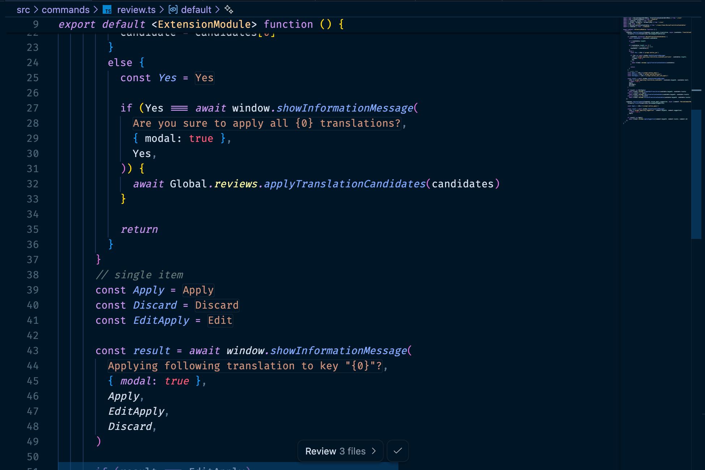

<p align="center">

</p>

<h1 align="center">i18n Ally Next</h1>

<p align="center">
<b>VS Code 全能国际化插件</b>
</p>

<p align="center">
<a href="https://github.com/lydanne/i18n-ally-next/blob/main/readme.md">English</a> | 简体中文
</p>

<p align="center">
<a href="https://marketplace.visualstudio.com/items?itemName=lydanne.i18n-ally-next"></a>
<a href="https://marketplace.visualstudio.com/items?itemName=lydanne.i18n-ally-next"></a>
<a href="https://marketplace.visualstudio.com/items?itemName=lydanne.i18n-ally-next"></a>
<a href="https://github.com/lydanne/i18n-ally-next"></a>
</p>

---

## 功能特性

- **🌍 内联注解** — 在代码中直接查看翻译内容
- **🔍 悬浮预览** — 悬浮即可预览所有翻译，一键编辑
- **📦 文案提取** — 检测硬编码字符串，一键提取到语言文件
- **🤖 机器翻译** — 支持 Google、DeepL、百度、OpenAI 及编辑器内置大模型（Cursor/Windsurf/VSCode Copilot）
- **🗂 命名空间** — 支持 `t("ns:key")` 风格的命名空间组织
- **📝 审阅系统** — 内置翻译审阅和团队协作
- **🧩 30+ 框架** — Vue、React、Angular、Svelte、Flutter 等
- **🎨 自定义框架** — 通过 YAML 配置定义你自己的框架
- **⚡ 一键翻译** — 一键翻译所有缺失和过期的文案
- **🕐 过期检测** — 检测源语言文案变更后的过期翻译，支持逐个或批量重新翻译
- **🔎 全项目扫描抽离** — 扫描整个项目的硬编码字符串，批量提取为 i18n key
- **🧠 编辑器大模型翻译** — 自动识别 VSCode 环境，调用内置大模型进行翻译，支持批量并发

## 快速开始

```jsonc
// .vscode/settings.json
{
  "i18n-ally-next.localesPaths": ["src/locales"],
  "i18n-ally-next.sourceLanguage": "en",
  "i18n-ally-next.displayLanguage": "zh-CN"
}
```

> 框架会从 `package.json` 自动检测。完整列表见[支持的框架](#支持的框架)。

## 截图

<h4 align="center">内联注解</h4>


<h4 align="center">悬浮预览与快捷操作</h4>


<h4 align="center">从代码中提取文案</h4>


## 支持的框架

| 分类 | 框架 |
| --- | --- |
| **Vue** | Vue I18n, Vue SFC, Fluent Vue |
| **React** | React I18next, React Intl, Lingui |
| **Next.js** | next-intl, next-i18next, next-translate, next-international |
| **Angular** | ngx-translate, Transloco |
| **其他** | Svelte, Ember, i18n-tag, Polyglot, Globalize, UI5 |
| **移动端** | Flutter |
| **后端** | Laravel, Ruby on Rails, PHP Gettext |
| **工具** | VS Code 扩展, Chrome 扩展, Jekyll |
| **自定义** | [定义你自己的框架](https://lydanne.github.io/i18n-ally-next/zh-CN/guide/custom-framework) |

## 内联注解模式

默认情况下，翻译文本以内联注解的形式显示在 key 后面。你可以自定义显示方式：

```jsonc
// .vscode/settings.json
{
  "i18n-ally-next.annotationInPlace": true,
  "i18n-ally-next.annotationInPlaceFullMatch": true
}
```

| 配置 | 效果 |
| --- | --- |
| `annotationInPlace: false` | `t('key')` · 翻译文本 |
| `annotationInPlace: true` | `t(`翻译文本`)` — 仅隐藏 key |
| `annotationInPlaceFullMatch: true` | 翻译文本 — 隐藏整个函数调用 |



> **提示：** 开启 `annotationInPlaceFullMatch` 后，将光标移到该行会自动恢复显示原始代码，方便编辑。该模式下 `annotationMaxLength` 限制会自动取消，翻译文本完整显示，不会被截断。

全量替换模式下翻译文本默认使用 `#ce9178`（Dark+ 主题的字符串颜色）。你可以自定义颜色：

```jsonc
// .vscode/settings.json
{
  "i18n-ally-next.theme.annotationInPlaceFullMatch": "#ce9178" // 深色主题
  // "i18n-ally-next.theme.annotationInPlaceFullMatch": "#a31515" // 浅色主题
}
```

## 可选依赖

部分高级功能需要在**你的项目中**额外安装依赖：

| 功能 | 使用场景 | 安装命令 |
| --- | --- | --- |
| **Vue SFC `<i18n>` 块** | 在 `.vue` 文件中使用内联 `<i18n>` 翻译块 | 扩展已内置 |
| **Fluent Vue SFC** | 在 `.vue` SFC 文件中使用 Fluent 语法 | `npm i -D fluent-vue-cli` |

> **提示：** 如果你使用独立的翻译文件（如 `locales/en.json`），则无需安装任何额外依赖。以上依赖仅在使用 SFC 内联翻译块时需要。

## 文档

📖 **[完整文档](https://lydanne.github.io/i18n-ally-next/zh-CN/)** — 快速开始、配置项、命名空间、自定义框架等。

## ❤️ 致谢

本插件最初受 [think2011/vscode-vue-i18n](https://github.com/think2011/vscode-vue-i18n) 启发，早期 Vue SFC 支持使用了 [kazupon/vue-i18n-locale-message](https://github.com/kazupon/vue-i18n-locale-message)。

### 贡献者

<a href="https://github.com/lydanne/i18n-ally-next/graphs/contributors"></a>

## 📄 License

[MIT](./LICENSE) © 2025 至今 [Lydanne](https://github.com/lydanne) | MIT © 2021-2024 [Lokalise](https://github.com/lokalise) | MIT © 2019-2020 [Anthony Fu](https://github.com/antfu) | MIT © 2018-2019 [think2011](https://github.com/think2011)
